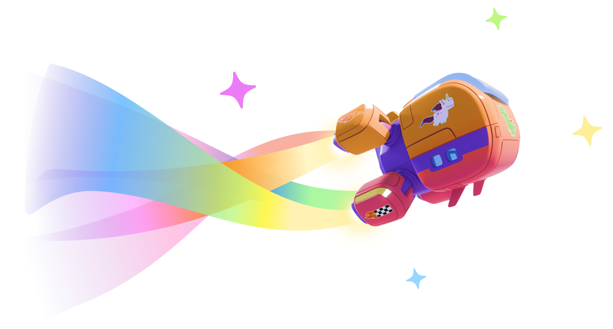

> [!IMPORTANT]
> Union is deprecated. Use [Unity's official MCP server](https://docs.unity3d.com/Packages/com.unity.ai.assistant@2.6/manual/integration/unity-mcp-overview.html).


# Union ♾️ - The Unity MCP Server

> A Model Context Protocol server for Unity



## Key Features

- 🖼️ **Multimodal Vision**: Your agent can see what you see. It can view the scene, look through any camera, watch play mode, and inspect asset thumbnails.

- 🔎 **Powerful Search**: Go beyond the project panel with simultaneous search across the hierarchy and project assets.

- ✔️ **Superior Code Analysis**: Leverage Unity's own compiler for code analysis that is more accurate than your agent's linter.

- ⏩ **Quick Start**: Get running in seconds with a single `mcp.json` configuration file.

- 🛠️ **Extensible**: Add your own project-specific tools with minimal boilerplate.

- 📅 **Always Current**: Kept up-to-date with the latest MCP protocol version — currently `2025-06-18` via the [Official MCP C# SDK](https://github.com/modelcontextprotocol/csharp-sdk).

## Compatibility

| Name                  | Compatible | Notes                                                                 |
| --------------------- | ---------- | --------------------------------------------------------------------- |
| **Models**            |            |                                                                       |
| GPT-4.1               | ✅         |                                                                       |
| Claude 4 Sonnet       | ✅         |                                                                       |
| Claude 4 Opus         | ✅         |                                                                       |
| Gemini 2.5 Pro        | ✅         |                                                                       |
| Gemini 2.5 Flash      | ✅         |                                                                       |
| o3                    | ✅         | No image understanding                                                |
| o4-mini               | ✅         |                                                                       |
| **Unity Versions**    |            |                                                                       |
| Unity 6000.0.x        | ✅         | Higher versions should be fine. Lower versions may work but untested. |
| **Agents**            |            |                                                                       |
| Cursor                | ✅         |                                                                       |
| Rider AI              | ✅         |                                                                       |
| Claude Desktop        | ✅         |                                                                       |
| Claude Code           | ✅         | Terminal requires Screen & System Audio Recording permissions on Mac  |
| **Operating Systems** |            |                                                                       |
| Windows               | ✅         |                                                                       |
| Mac                   | ✅         |                                                                       |
| Ubuntu                | ❔         | Untested                                                              |

## Setup

### 1. Install [node.js](https://nodejs.org/en/download)

### 2. Configure `mcp.json`

```json
{
  "mcpServers": {
    "unity": {
      "command": "npx",
      "args": ["-y", "@nurture-tech/unity-mcp-runner", "-unityPath", "<path to unity editor>", "-projectPath", "<path to unity project>"]
    }
  }
}
```

This will automatically install the `is.nurture.mcp` package in your unity project. Feel free to commit those changes to source control.

## About the Tools

> Meet your Unity AI toolbox.

| Tool                 | Description                                                                                            |
| -------------------- | ------------------------------------------------------------------------------------------------------ |
| **Assets**           |                                                                                                        |
| `get_asset_contents` | Get the full contents of an asset or sub-asset.                                                        |
| `copy_asset`         | Copy an asset to a new path.                                                                           |
| `import_asset`       | Import an asset from the filesystem into Unity.                                                        |
| `get_asset_importer` | Get the importer settings for an asset.                                                                |
| **Prefabs**          |                                                                                                        |
| `open_prefab`        | Open a Unity prefab in isolation mode so that it can be edited.                                        |
| **Scenes**           |                                                                                                        |
| `open_scene`         | Open a scene                                                                                           |
| `close_scene`        | Close an open scene                                                                                    |
| `save_scene`         | Save the current scene. If the scene is not dirty, this will do nothing.                               |
| `get_game_object`    | Get the details of a game object in a loaded scene or prefab by its hierarchy path.                    |
| `test_active_scene`  | Test the active scene by entering play mode and running for a given number of seconds.                 |
| **Scripting**        |                                                                                                        |
| `create_script`      | Create or replace a C# code file at the given path. This also checks to make sure the script compiles. |
| `execute_code`       | Execute code inside the Unity editor.                                                                  |
| `get_type_info`      | Get public fields and methods on a Unity fully qualified type name, including the assembly.            |
| **Search**           |                                                                                                        |
| `search`             | Search project assets and scene objects.                                                               |
| **Editor State**     |                                                                                                        |
| `get_state`          | Get the state of the Unity Editor.                                                                     |
| `get_selection`      | Get the objects the user has currently selected in the editor.                                         |
| **Vision**           |                                                                                                        |
| `focus_game_object`  | Focus on a game object in the scene view.                                                              |
| `screenshot`         | Retrieve a preview of what is focused in the scene view.                                               |

## Known Issues

- The Google External Dependency Manager (EDMU) causes Unity to hang forever on startup when launched via Cursor on Windows. This is under investigation.

- The `test_active_scene` tool sometimes fails with the error message `Maximum call stack size exceeded.`

- The `search` tool occasionally fails with the error message `Search index is not ready yet. Please try again later.`

## Adding Project-Specific Tools

Union uses the official [C# MCP SDK](https://github.com/modelcontextprotocol/csharp-sdk).

1. Create a static class to hold your tools. Add the `[McpServerToolType]` annotation to the class.

2. Declare static methods to implement each tool. Add the `[McpServerTool]` annotation to each method.

3. Reference the [Services](./packages/unity/Editor/Services) directory for examples.

4. You will likely need to quit unity and restart your agent in order for it to see the new tools.

## Usage Tips

Here are some tips to get the most out of Union:

- 🚀 **Launch through your agent**: Always launch Unity through your AI agent's MCP integration. Launching Unity from the Hub will prevent the MCP server from connecting.

- 📂 **Per-project setup**: If your agent supports it, configure the MCP server in your per-project settings. This allows you to seamlessly switch between Unity projects.

- ⚙️ **Command-line arguments**: You can pass additional arguments to Unity for advanced scenarios like running in `-batchmode` or `-nographics` for CI/CD pipelines. Add a `--` separator before the Unity-specific arguments:

  ```json
  {
    "mcpServers": {
      "unity": {
        "command": "npx",
        "args": [
          "-y",
          "@nurture-tech/unity-mcp-runner"
          "-unityPath",
          "<path to unity editor>",
          "-projectPath",
          ".",
          "--",
          "-batchmode",
          "-nographics"
        ]
      }
    }
  }
  ```

- ⚠️ **Important**: Do not use the `-logFile` command-line argument. The MCP server relies on Unity's standard output for communication.

- 🖥️ **Split screen for vision**: For tools like `screenshot`, ensure the Unity editor is visible on your screen otherwise it will end up screenshotting the foreground window.
